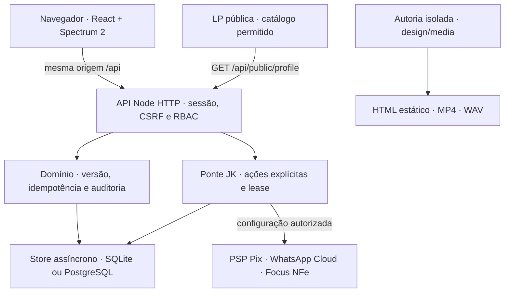
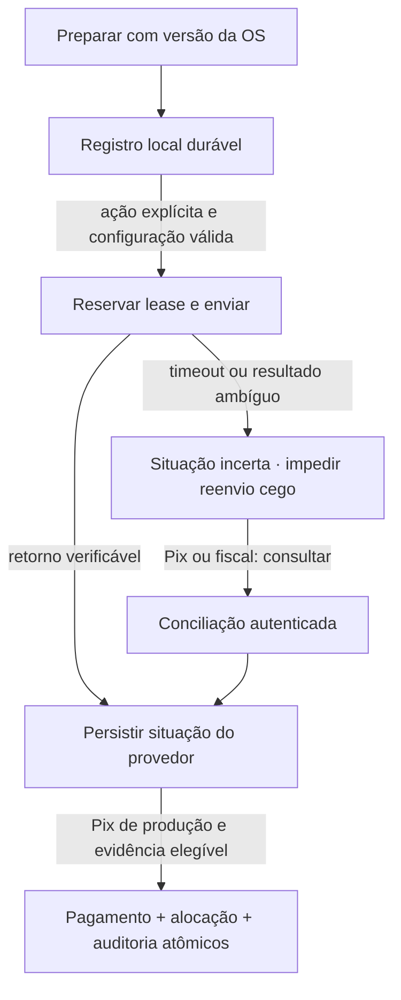

# AB-JK-UASH — arquitetura implementada

Esta documentação descreve o código verificado em **28/10/2026**, não o estado de um servidor remoto. O AB-JK-UASH é um cliente próprio da JK baseado no AB-UASH 0.2.1, com SPA React/Spectrum 2, API Node HTTP e armazenamento relacional. O núcleo opera com o contrato `/api`; não utiliza o backend `/api/v1` da main AB-UASH como serviço remoto.

## Origem e limites da composição

| Camada | Origem / decisão |
| --- | --- |
| Aplicação operacional | Snapshot AB-UASH 0.2.1 `630d295aaa72a7fe08cacde6182c07790638ba91`, preservando domínio, RBAC, API, UI e testes. |
| Ponte Pix / WhatsApp | Subconjunto de conectores da main `b2dc7785ef99166287f06dead2d985def8eb36b0`, transformado de TypeScript para `.mjs` e adaptado ao store assíncrono. Arquivos e hashes em [manifest](../integrations/jk/vendor/manifest.json). |
| Fiscal | Adaptador Focus NFe da base 0.2.1; não foi importado outro motor fiscal da main. |
| Extensões JK | Perfil público/LP, migração canônica com histórico separado, transporte de retirada/devolução e ponte de integrações com ações explícitas. |
| Autoria visual | Diagram Design, Hyperframes, Earshot e ManimGX em `design/`, sem dependência desses motores no runtime da aplicação. |

Nenhum banco, senha, sessão, certificado, exportação de cliente ou configuração privada de provedor foi copiado da origem. A base pública contém código e fixtures sintéticas. O produto é uma instalação de uma empresa: **não existe chave de tenant/unidade nem isolamento multiempresa no domínio**. A separação entre empresas exige implantação/banco próprios ou nova arquitetura explícita.

## Componentes e fronteiras

A seta aos provedores representa capacidade condicionada à configuração; não comprova comunicação externa executada. O pipeline visual não recebe banco de clientes nem segredos da operação. Seus arquivos de saída podem ser revisados independentemente em [review.html](../design/media/review.html).

## Frontend e navegação

[src/main.tsx](../src/main.tsx) inicializa React 19 com `Provider` do pacote `@react-spectrum/s2`, locale `pt-BR` e tema claro. O build usa Vite, TypeScript e o macro Spectrum configurado em [vite.config.ts](../vite.config.ts). Versões concretas e resolução de dependências ficam no manifesto e lockfile raiz.

[src/App.tsx](../src/App.tsx) escolhe a LP em `/` e carrega o aplicativo operacional por importação lazy em `/app` ou hash operacional. [RootApp](../src/RootApp.tsx) consulta `/api/status`, apresenta configuração/login e, após sessão, despacha páginas lazy. A navegação interna usa fragmentos de URL; não é Next.js nem roteamento SSR. As páginas principais são:

| Grupo | Fragmentos |
| --- | --- |
| Operação | `dashboard`, `orders`, `orders/:id`, `checklist`, `appointments`, `deliveries` |
| Cadastros | `customers`, `vehicles`, `services`, `employees`, `products`, `packages` |
| Gestão | `cash`, `invoices`, `fiscal`, `package-sales`, `payroll`, `reports` |
| Comunicação / administração | `messages`, `integrations`, `migration`, `settings` |

Os controles de interface respeitam papéis, mas a autorização efetiva é aplicada pela API. O [cliente HTTP](../src/lib/api.ts) envia cookie, CSRF, versão e chave idempotente conforme a operação. Mensagens de erro e estados vazios derivam de resultados da API; falta de banco não cria dados demonstrativos.

A LP consulta somente o perfil público explicitamente permitido em [jk-public.mjs](../server/jk-public.mjs): nome, Instagram informado, localização configurada no perfil e serviços ativos com preço/duração. Não consulta clientes, OS ou faturamento. `acceptingOnlineBookings:false` deixa explícita a ausência de reserva pública. Ilustrações são originais; não representam fotografias reais do estabelecimento. O link de contato fornecido é `https://www.instagram.com/lavar.apidojk/`.

## API, autenticação e autorização

[server/application.mjs](../server/application.mjs) monta um servidor HTTP Node nativo, o store, migrações locais e a cadeia de handlers. [http.mjs](../server/http.mjs) trata limites de corpo, origem, cabeçalhos e arquivos estáticos. Endpoints públicos incluem saúde, prontidão, estado da sessão e perfil público; mutações de domínio exigem sessão e CSRF.

As senhas são derivadas por scrypt com salt aleatório; as sessões têm token aleatório, hash persistido e validade absoluta de oito horas. O cookie é `HttpOnly`, `SameSite=Strict` e usa `Secure` conforme o perfil de implantação. CSRF é separado da sessão. Sessões consultam o usuário ativo e as mutações revalidam papel vivo dentro da transação, inclusive antes de devolver replay. Login possui limitação persistida de tentativas. [Implementação de segurança](../server/security.mjs).

| Papel | Responsabilidades verificadas |
| --- | --- |
| `admin` | Usuários e migração, além da gestão e operação. |
| `manager` | Serviços/produtos/equipe/pacotes, caixa, pós-pago, folha, configurações, relatórios e integrações. |
| `operator` | Clientes/veículos, OS, agenda, transporte, checklist/fotos, consumo e registro de recebimentos, conforme a rota. |
| `viewer` | Consulta permitida da operação; sem mutações e sem acesso à agenda privada de transportes. |

Os papéis não expressam filiais ou propriedade por cliente. Campos sensíveis de salário/comissão e indicadores financeiros são filtrados para papéis restritos. O provisionamento do primeiro administrador exige o fluxo seguro de setup; senha não é conteúdo de repositório. O perfil serverless valida origem e configuração antes de inicializar a aplicação, sem aceitar cabeçalho de requisição como seletor de banco. [vercel-runtime](../server/vercel-runtime.mjs).

## Persistência e invariantes

[db.mjs](../server/db.mjs) fornece a interface assíncrona comum. No perfil local, `node:sqlite` abre um arquivo privado, ativa foreign keys, WAL, `synchronous=FULL` e `trusted_schema=OFF`. Tabelas são STRICT; escrita usa transações serializadas e controle de versão. Base e sidecars recebem permissões restritas. O esquema da base está em [domain-schema.mjs](../server/domain-schema.mjs); migrações adicionais criam tabelas de fotos, fiscal e extensões sem importar o schema incompatível da main.

No perfil PostgreSQL, `pg` é usado somente pelo backend. Schema e privilégios são preparados pela implantação; o runtime não assume DDL livre. O browser não possui URL de banco, senha PostgreSQL, chave de serviço ou acesso direto à Data API. O fato de o banco poder ser hospedado no Supabase **não muda a autenticação para Supabase Auth**: usuários/sessões/papéis continuam sendo os da aplicação.

Valores monetários são inteiros em centavos. Percentuais usam basis points (`10000 = 100%`), estoque usa milésimos (`1000 = 1 unidade`) e datas com horário são normalizadas para ISO UTC; relatórios convertem o período pelo fuso configurado, normalmente `America/Sao_Paulo`. Totais agregados usam verificações de inteiro seguro e cálculo proporcional sem flutuação monetária.

Mutações de domínio exigem `Idempotency-Key`, vinculada ao ator, método, caminho e conteúdo canônico. Repetição do mesmo comando devolve o resultado persistido; conteúdo diferente com a mesma chave é conflito. Operação, auditoria e resposta idempotente gravam juntas. O controle `version` rejeita edição baseada em leitura antiga. Autenticação e gerenciamento de usuários possuem contratos próprios; não se deve declarar idempotência/versionamento uniforme em toda rota do servidor. [domain-core](../server/domain-core.mjs), [contrato API](api/README.md).

## Modelo de domínio

| Conjunto de tabelas | Papel e relações |
| --- | --- |
| `customers`, `vehicles`, `services`, `employees`, `products`, `packages` | Cadastros, placa/SKU únicos e desativação. Veículo pertence a cliente; pacote referencia serviço. |
| `orders`, `order_items` | OS e snapshots de nome/preço/duração/comissão; vínculo cliente/veículo/responsável. Não são simples referências a preços correntes. |
| `appointments` | Reserva por intervalo/responsável; conversão única para OS. |
| `order_photos` | Imagem binária autenticada com legenda, autor, limites e vínculo à OS. Não há bucket público de fotos. |
| `stock_movements` | Entradas, ajustes, consumo por OS e reversão referenciada única. |
| `payments`, `payment_allocations`, `cash_sessions`, `cash_movements` | Recebimento, alocação por OS e caixa físico separado dos métodos digitais. |
| `invoices`, `invoice_orders` | Fechamento pós-pago e saldos por OS sem dupla fatura ativa. |
| `package_sales`, `package_redemptions` | Venda paga, créditos, validade e consumo; resgate não é nova receita. |
| `payroll`, `payroll_lines`, `commission_claims` | Fechamento de remuneração interna; OS comissionada reservada para uma linha. |
| `messages` | Rascunhos e fila local; não são log de entrega WhatsApp. |
| `users`, `sessions`, `auth_attempts`, `audit_events`, `idempotency_keys`, `app_settings` | Identidade, autorização, replay, auditoria e configuração local. |
| `jk_*` | Ponte de integrações, transporte e migração/histórico; cada extensão tem schema explícito. |

### OS, agenda e transporte

O [diagrama estático de atendimento](../design/diagram/order-lifecycle.html) deriva das transições de [domain-orders](../server/domain-orders.mjs). Os estados são `quote`, `scheduled`, `waiting`, `in_progress`, `quality_check`, `ready`, `delivered`, `cancelled`. A conferência e pronta permitem retornar a execução. Cancelamento é bloqueado com pagamento, crédito/consumo ativo ou fatura. Entrega exige saldo zero, exceto pós-pago. Não há reabertura de estados finais.

Itens capturam preço, duração e comissão; mudanças posteriores no cadastro não alteram automaticamente a OS. Alterar apenas o responsável preserva os snapshots. O desconto é distribuído proporcionalmente em centavos; a taxa do serviço, quando positiva, prevalece sobre a taxa do empregado. Não há rateio entre múltiplos executores.

Agenda verifica sobreposição do responsável com agendamentos e OS programadas; intervalos adjacentes são válidos. Conversão cria uma OS e mantém seu vínculo. O módulo JK de [delivery](../server/jk-deliveries.mjs) adiciona reserva de retirada/devolução que também participa da disponibilidade. Ele preserva endereço, vínculo canônico ao atendimento, versões e eventos. Concluir devolução pode entregar a OS na mesma transação, após conferir a situação e o saldo; falha/cancelamento de tarefa exige motivo. Mapas, geocodificação e GPS não estão implementados.

### Financeiro, pacote e folha

Recebimentos manuais validam saldo e registram alocações na mesma transação. Dinheiro requer caixa aberto; Pix/cartão/transferência manuais exigem conferência humana externa e não representam autorização bancária pelo simples clique. Uma fatura distribui o recebimento entre suas OS sem exceder o saldo. [domain-finance](../server/domain-finance.mjs).

Venda de pacote registra a receita uma vez. Resgate valida cliente, serviço, validade, saldo e quantidade da linha e reduz créditos; reversão segue condições do domínio. Folha calcula base, comissões elegíveis, extras e descontos; aprovação fixa o fechamento e pagamento é único. A comissão depende de OS entregue e quitada e usa como competência o momento mais recente entre esses eventos. Isso é controle interno, não folha trabalhista completa. [domain-office](../server/domain-office.mjs).

### Fotos, OCR e documentos

Fotos ficam no armazenamento autenticado, limitadas a oito por OS e 1,5 MiB cada, JPEG/PNG, no máximo 8192 por dimensão e 16 MP. O servidor verifica cabeçalhos, dimensão, base64, sessão e situação da OS. Uma conta com leitura operacional pode ver as fotos da instalação; não existe segregação por tenant. [media.mjs](../server/media.mjs).

OCR é executado pelo worker Tesseract no navegador com ativos locais preparados em build e licença/proveniência próprias. A pessoa confirma a sugestão; não há consulta de proprietário. [internal/ocr](../internal/ocr/README.md). Documentos operacionais são HTML de impressão com identificação **não fiscal**; salvar em PDF é recurso do navegador. O cliente não possui serviço genérico de geração/envio de PDF.

## Integrações externas: comando explícito, estado durável

O cliente não executa worker automático de Pix/WhatsApp. A preparação cria registro local ligado à versão da OS; envio e conciliação são ações explícitas de usuário autorizado. Configuração reside no servidor e readiness informa bloqueios, provedor e ambiente sem expor segredos. [Contrato completo](../integrations/jk/README.md).

Pix usa Efí ou Inter com transporte HTTPS e certificado/configuração confinados. Criar cobrança não quita a OS. Para baixar, o reconciliador verifica evidência autenticada, referência, valor, ambiente/conta e unicidade do comprovante, além de saldo e versão atuais. Pagamento manual concorrente ou evidência parcial/devolvida vai para revisão, sem exceder o saldo. Homologação nunca baixa OS real. Timeout não autoriza nova criação às cegas. Não há webhook, estorno, cancelamento bancário de cobrança enviada ou agendador.

WhatsApp usa modelo e parâmetros da Cloud API com telefone do cliente da OS e confirmação de consentimento na preparação. O sucesso indica aceitação pelo provedor; entrega permanece não confirmada. A fila `messages` da base continua local. A ponte `jk_*` possui estados próprios; não se deve interpretar `queued` do módulo antigo como envio externo. Não há confirmação por webhook ou nova tentativa automática.

Fiscal usa rascunhos imutáveis, configuração Focus NFe/gateway, revisão tributária explícita, lease e consulta. O fluxo preserva situações `uncertain`/`pending` e não repete envio após resultado ambíguo. Emissão autorizada depende do provedor. Cancelamento implementado no cliente refere-se à preparação local elegível, não ao cancelamento de nota autorizada. O status `homologated:false` é deliberado até existir evidência externa. [server/fiscal](../server/fiscal.mjs), [integrations/fiscal](../integrations/fiscal/index.mjs).

## Migração e histórico

O contrato JK `schemaVersion:1` é próprio. Não aceita diretamente o envelope canônico da outra implementação AB-UASH. Há seis coleções: clientes/veículos/serviços entram em cadastros; OS/itens/recebimentos entram em histórico `jk_history_*`. Dados nativos sem representação operacional podem ser preservados em `jk_migration_source_rows`, com acesso administrativo. [migration-jk.md](migration-jk.md).

A prévia não grava; valida esquema, identidade, vínculos, propriedade do veículo, totais, datas e limites. O SHA-256 vincula conteúdo/plano/estado relevante. A confirmação revalida dentro de transação e grava cadastros, histórico, origem, auditoria e replay atomicamente. Outro conteúdo para a mesma identidade ou outro snapshot nativo sem reconciliação é bloqueado. A ausência de IDs no layout nativo é declarada, não disfarçada por chaves inventadas de origem.

O histórico não lança receita, saldo exigível, comissão, estoque, documento ou mensagem na operação atual. A CLI de prévia abre SQLite somente leitura; a confirmação exige hash. Migração está restrita a SQLite e retorna `JK_MIGRATION_LOCAL_ONLY` em PostgreSQL. Nenhuma migração real está comprovada por esta documentação.

## Perfis de execução e operação

| Perfil | Características | Limite |
| --- | --- | --- |
| Node local / Compose | Build Vite estático e API na mesma origem; SQLite privado em volume persistente; bootstrap protegido; backup/restauração por CLI. | Navegador precisa alcançar o servidor. Não há fila offline por dispositivo nem sync entre bancos. |
| Node com PostgreSQL | Mesmo domínio através de store `pg`; schema/privilégios preparados antes do runtime. | Toda extensão precisa de migração SQL compatível; a migração Jumpcar não está habilitada neste perfil. |
| Vercel + PostgreSQL | Adaptador serverless, TLS/configuração/origens validados, sem banco SQLite efêmero como produção. | Código e configuração disponíveis não comprovam deploy, banco remoto saudável ou integração externa homologada. |

Saúde de processo (`/api/health`) difere de prontidão de banco (`/api/ready`) e da readiness dos conectores (`/api/jk/integrations/readiness`). A LP renderizada não prova disponibilidade do backend. [Sondagem](../scripts/healthcheck.mjs), [perfil de implantação](../deploy/README.md). A recuperação precisa cobrir banco, mídia armazenada e segredos/configuração privada preservados por procedimento próprio; o ensaio real no destino é um gate operacional.

## Autoria visual e custos de runtime

`design/diagram` contém fonte HTML/SVG acessível derivada do template Diagram Design e tokens resolvidos JK/Spectrum. `design/media` possui fontes Python/HTML, locks, avisos de terceiros, renderizador e recibos. Earshot usa só geração/auditoria procedural; ManimGX e Hyperframes geram MP4 fora do app. Não há Torch, pesos de modelos, Python, Rust/wgpu, Chrome ou Hyperframes player importados pelo frontend.

O vídeo de revisão usa `<video controls muted playsinline preload="none">`, reserva dimensões e não inicia automaticamente. O diagrama/texto oferece alternativa estática. A composição não modifica atendimento, estados da OS ou permissões. Os bytes de mídia e evidências de render ficam documentados em [DESIGN-MEDIA](DESIGN-MEDIA.md); não devem ser confundidos com tamanho do bundle da aplicação.

## Validação e lacunas arquiteturais

As suítes exercitam transações, concorrência, chaves idempotentes, autorização viva, restauração, fotos, OCR, contrato HTTP, migração e conectores via fixtures. A [matriz](FEATURE-MATRIX.md) relaciona cada módulo à sua fonte/teste e explicita o alcance. Resultados históricos da base não substituem execução no código final JK; testes de transporte simulado não homologam conta fiscal/bancária/mensageria.

A integração final concentra resultados de build/testes em [VALIDATION-JK.md](VALIDATION-JK.md), revisão independente em [REVIEW-JK.md](REVIEW-JK.md) e síntese do REA em [summary-jk.json](rea/summary-jk.json). O relatório e o manifesto registram o escopo da fonte congelada e os hashes usados na validação; resultados locais não substituem os gates da instalação real.

Faltam, conforme o escopo desejado, multiunidade, sincronização offline, SmartPOS/TEF, loja/venda de produto na OS, CRM automatizado, comissões fixas/rateio, emissão fiscal de mercadoria, mapa/GPS e recebimento por webhook. Esses itens são trabalho de produto e engenharia. Configurar segredos habilita adaptadores existentes, mas não cria esses módulos.
